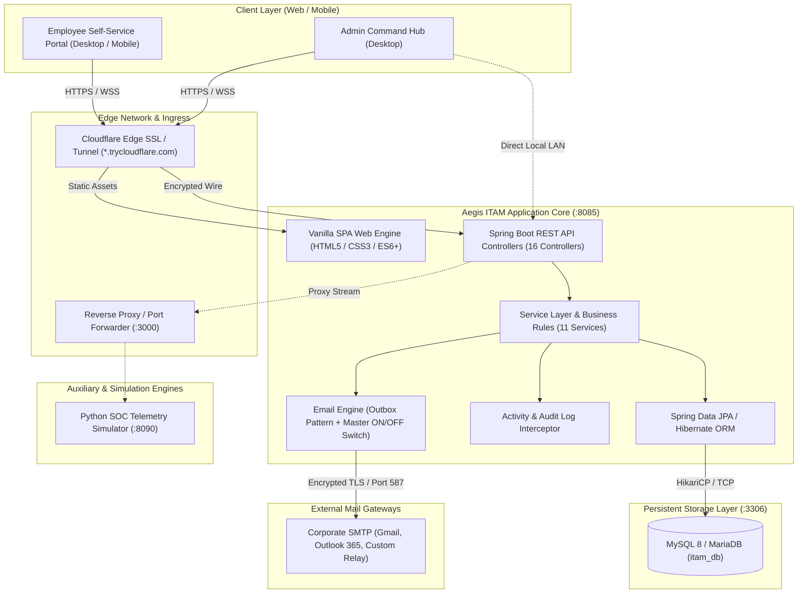
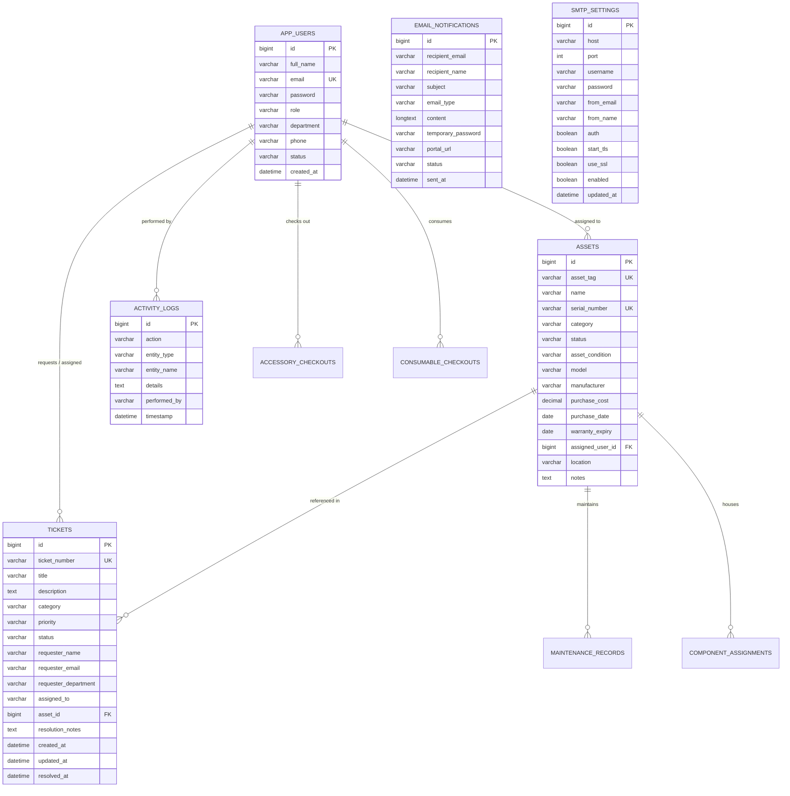
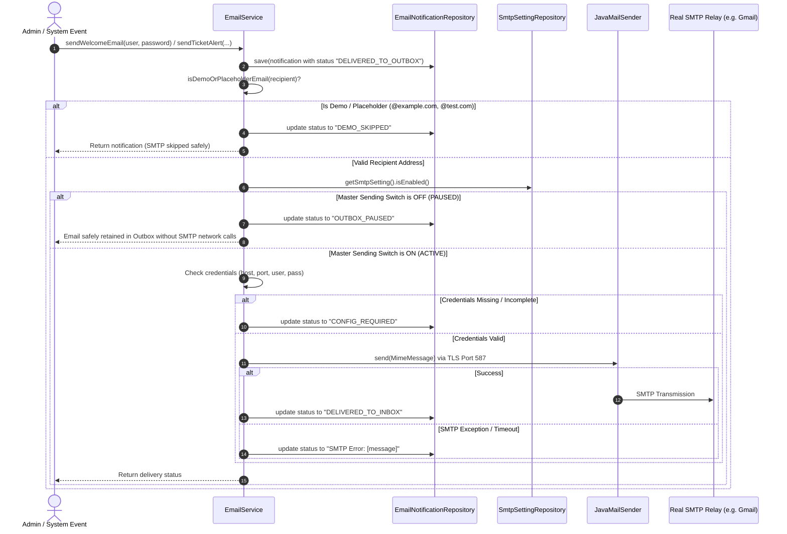
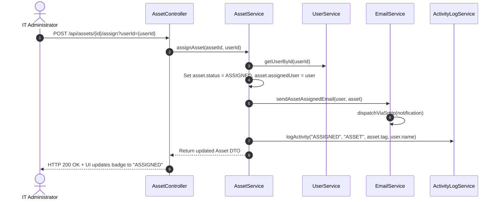
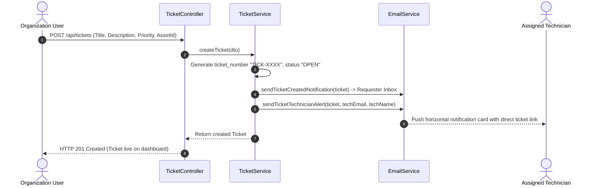
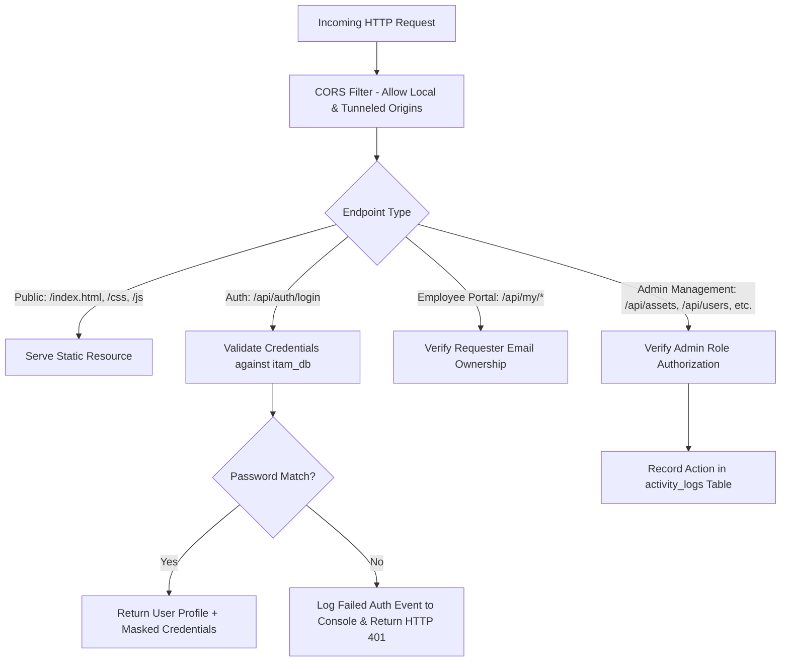
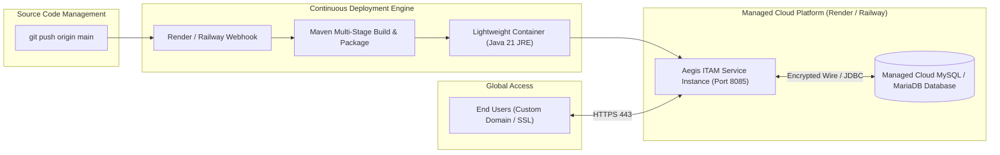

# Aegis IT Asset Management (ITAM) - Complete System Design Document

**Document Version:** 1.0.0  
**Target System:** Enterprise IT Asset Lifecycle, Support Ticketing & Automated Notification Platform  
**Architecture Style:** Modular Monolith (Spring Boot 3 + JPA) with Decoupled Vanilla SPA Frontend & Hybrid Cloud Tunneling  
**Author / Engineering Team:** Antigravity Pair-Programming Assistant & IT Engineering  

---

## 1. Executive Summary & System Objectives

Aegis IT Asset Management (ITAM) is a centralized, enterprise-grade hardware and software governance platform designed for modern organizations. It unifies physical asset tracking, employee hardware provisioning, IT support helpdesk ticketing, and automated email communications into a single interface.

### Core Problems Solved
1. **Hardware Loss & Ghost Assets:** Eliminates untracked hardware purchases, lost laptops, and missing equipment through serial-number and asset-tag tracking.
2. **Accountability Gaps:** Binds physical assets directly to employee profiles, departments, and purchase histories with full audit logging.
3. **Fragmented IT Helpdesk:** Replaces disjointed email threads and chat messages with a structured ticketing workflow tied directly to problematic assets and assigned technicians.
4. **Communication Delays:** Automates credential dispatch for new hires and real-time status updates for service desk tickets via an internal Outbox with real SMTP failover.
5. **Operational Visibility:** Provides executive dashboards with live financial depreciation estimates, equipment condition analytics, and real-time SOC security posture telemetry.

---

## 2. High-Level System Architecture

Aegis ITAM follows a **Modular Monolith** architecture pattern. The application is packaged as a single deployable unit backed by a relational database, with clearly separated presentation, business service, and data access boundaries.

---

## 3. Technology Stack & Component Specifications

| Tier | Technology | Rationale & Technical Characteristics |
| :--- | :--- | :--- |
| **Backend Framework** | Java 21, Spring Boot 3.3.4 | Modern LTS Java runtime, native virtual threads readiness, robust dependency injection, embedded Tomcat 10. |
| **Data Persistence** | Spring Data JPA, Hibernate 6.5 | Object-Relational Mapping (ORM), automated schema management (`ddl-auto=update`), derived repository queries. |
| **Connection Pool** | HikariCP | High-performance, zero-overhead JDBC connection pooling. |
| **Database** | MySQL 8.0+ / MariaDB | Relational ACID compliance, foreign key integrity, index optimization, JSON payload support. |
| **Frontend UI** | Vanilla HTML5, Modern CSS3, JavaScript ES6+ | Zero build step, sub-50ms initial load time, native browser performance, glassmorphism dark-theme aesthetics. |
| **Email Protocol** | Jakarta Mail, JavaMailSender | Standards-compliant MIME/HTML formatting, STARTTLS encryption, socket timeouts (10s fail-safe). |
| **Edge Tunneling** | Cloudflare Tunnel (`cloudflared`) | End-to-end encrypted Zero Trust tunneling; eliminates port-forwarding and dynamic DNS challenges. |
| **API Documentation** | Springdoc OpenAPI 3 / Swagger UI | Automated interactive API catalog exposed at `/swagger-ui.html` and `/v3/api-docs`. |

---

## 4. Database Schema & Entity Relationship Model

The database schema is organized around core IT resources, employee identities, operational tickets, communication outbox items, and audit records.

---

## 5. Subsystem Design & Workflow Sequences

### 5.1 Outgoing Mail Subsystem with Master ON/OFF Switch

To prevent accidental mail spamming, connection timeouts, or credential leaks during testing, the email subsystem implements the **Outbox Pattern** coupled with a **Master Control Guard**.

---

### 5.2 Asset Allocation & Lifecycle Transition Workflow

---

### 5.3 IT Support Ticket Lifecycle & Technician Alert Dispatch

---

## 6. Security, Authentication & Role-Based Access Control (RBAC)

Aegis ITAM implements a defense-in-depth security model:

### Key Security Safeguards
1. **Password Masking:** The SMTP controller and user details API responses permanently mask raw passwords (`••••••••`) across network responses.
2. **Demo Anti-Spam Guard:** The email dispatcher strictly inspects recipient addresses against demo domains (`@example.com`, `@test.com`, `@company.com`). Real SMTP traffic is never dispatched to dummy addresses.
3. **Immutable Audit Trail:** All database modifications (CREATE, UPDATE, DELETE, CHECKOUT, ASSIGN) are recorded in the `activity_logs` table with the performing administrator's identity.

---

## 7. Cloud Deployment & Production Blueprint

While the application currently runs locally and can be accessed via Cloudflare Tunnel, the production blueprint ensures 24/7 availability independently of local hardware.

### Production Environment Variables Configuration

| Variable Name | Description | Example / Recommended Value |
| :--- | :--- | :--- |
| `SERVER_PORT` | HTTP port for incoming traffic | `8085` or dynamic `$PORT` |
| `SPRING_DATASOURCE_URL` | Cloud MySQL connection string | `jdbc:mysql://db.host:3306/itam_db?useSSL=true` |
| `SPRING_DATASOURCE_USERNAME` | Database master user | `admin` |
| `SPRING_DATASOURCE_PASSWORD` | Secure database secret | `[Secret]` |
| `SPRING_MAIL_HOST` | Outgoing SMTP host | `smtp.gmail.com` |
| `SPRING_MAIL_PORT` | SMTP port | `587` |
| `SPRING_MAIL_USERNAME` | Authorized sender account | `it-support@organization.com` |
| `SPRING_MAIL_PASSWORD` | App-specific SMTP secret | `[Secret App Password]` |
| `ITAM_MAIL_ENABLED` | Master switch boot default | `true` or `false` |

---

## 8. REST API Endpoints Catalog

| Domain | Method | Endpoint | Description |
| :--- | :--- | :--- | :--- |
| **Authentication** | `POST` | `/api/auth/login` | Verify credentials, determine role (ADMIN vs EMPLOYEE). |
| **Assets** | `GET` | `/api/assets` | Retrieve all hardware assets with search/filters. |
| **Assets** | `POST` | `/api/assets` | Register a new asset tag and specifications. |
| **Assets** | `POST` | `/api/assets/{id}/assign` | Assign hardware to an employee and trigger email. |
| **Assets** | `POST` | `/api/assets/{id}/unassign` | Return hardware to unassigned inventory. |
| **Tickets** | `GET` | `/api/tickets` | Query support desk tickets with status filters. |
| **Tickets** | `POST` | `/api/tickets` | Raise new ticket, notify requester & assigned tech. |
| **Tickets** | `PUT` | `/api/tickets/{id}` | Update status, priority, or resolution notes. |
| **Users** | `GET` | `/api/users` | List organization personnel and assignment counts. |
| **Users** | `POST` | `/api/users` | Onboard employee, generate password, dispatch email. |
| **Employee Portal** | `GET` | `/api/my/overview?email=..` | Scoped employee data: hardware, software, tickets. |
| **Email Outbox** | `GET` | `/api/emails` | Fetch all historical notification records. |
| **Email Outbox** | `DELETE`| `/api/emails` | Purge outbox history. |
| **SMTP Switch** | `GET` | `/api/smtp/status` | Read master sending state (`enabled: true/false`). |
| **SMTP Switch** | `POST` | `/api/smtp/toggle` | 1-click master ON/OFF toggle for outgoing email. |
| **SMTP Config** | `POST` | `/api/smtp/settings` | Save host, port, credentials, and encryption flags. |
| **SMTP Test** | `POST` | `/api/smtp/test` | Transmit instantaneous test email via live SMTP. |
| **Audit Logs** | `GET` | `/api/activity-logs` | Retrieve chronological administrative audit trail. |
| **Dashboard** | `GET` | `/api/dashboard/summary` | Consolidated counts, financial totals, and KPIs. |

---

## 9. Non-Functional Requirements & Scalability Strategies

1. **Performance & Sub-Second Latency:**
   - **GZIP Compression:** Spring Boot automatically compresses all text, HTML, and JSON responses above 1 KB (`server.compression.enabled=true`), reducing network payload by ~80%.
   - **Client-Side In-Memory Cache:** The frontend caches asset and ticket lists in `App.cachedAssets`, enabling instantaneous search and filtering without round-trip database queries.
2. **Reliability & Fault Tolerance:**
   - **Outbox Isolation:** If the external SMTP server goes down or rejects credentials, the primary business action (creating a ticket or onboarding an employee) still succeeds without failing the HTTP request.
   - **Connection Pool Resilience:** HikariCP automatically validates connections on borrowing, discarding stale socket connections cleanly.
3. **Auditability & Compliance:**
   - Every administrative action is linked with a timestamp and user ID, providing ISO 27001 / SOC 2 asset compliance audit trails.
